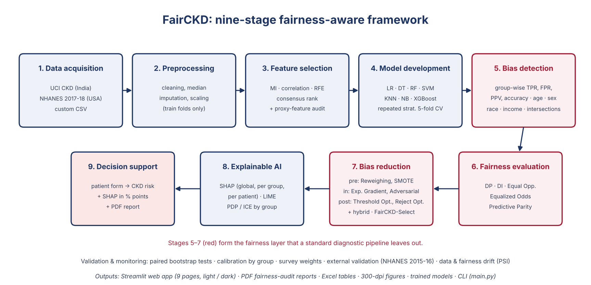
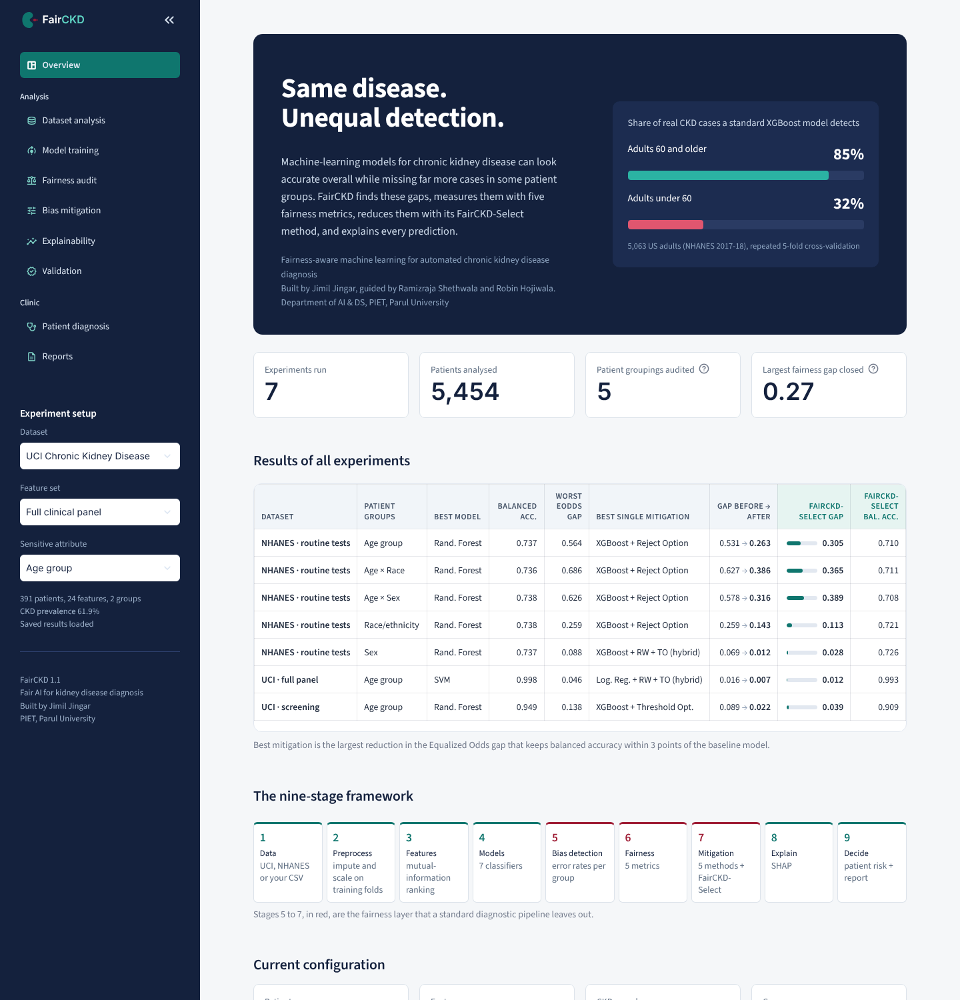

# FairCKD: Fairness-aware Machine Learning System for Automated CKD Diagnosis

[](https://fairckd.streamlit.app/)
[](https://jimiljingar-dotcom.github.io/FairCKD-Bias-Mitigation/)

**▶ Try the app live: https://fairckd.streamlit.app/** (no installation needed)

Built by **Jimil Jingar** · Guide: Ramizraja Shethwala · Co-guide: Robin Hojiwala<br>
Department of Artificial Intelligence & Data Science, PIET, Parul University

FairCKD is a complete software system built on a nine-stage fairness-aware framework:
it trains CKD diagnosis models, **detects** bias between patient groups, **measures** it with five fairness metrics,
**reduces** it with pre-, in- and post-processing techniques, **explains** predictions with SHAP and LIME, and offers a
**clinical decision-support** web application with downloadable patient reports.



---

## 1. Quick start

### Windows (easiest)
1. Install **Python 3.10 or newer** from python.org (tick *"Add Python to PATH"* during installation).
2. Download this repository (green **Code** button → **Download ZIP**) and unzip it, or clone it:
   `git clone https://github.com/jimiljingar-dotcom/FairCKD-Bias-Mitigation.git`
3. Double-click **`run_app.bat`**. The first run installs the libraries (a few minutes), then the app opens in the browser at http://localhost:8501.

### Any OS (terminal)
```bash
pip install -r requirements.txt
streamlit run app/Home.py          # web application
python main.py --all               # re-run all experiments (~1-2 hours)
python -m pytest -q                # run the 36 automated tests
```

All experiments are **already computed** and stored in `results/`, and the trained models in `models/`,
so the app works immediately without re-running anything.



---

## 2. The web application (9 pages)

| Page | Framework stage | What you can do |
|---|---|---|
| **Overview** | overview | the 9-stage framework, results dashboard of all experiments, key findings |
| **Dataset analysis** | 1-3 | group representation, CKD prevalence per group, missing values, feature ranking, upload your **own CSV** |
| **Model training** | 4 | train and compare 7 ML models live (or view saved results) |
| **Fairness audit** | 5-6 | sensitivity / false-positive rate / precision per group; DP, DI, EOpp, EOdds, PP metrics |
| **Bias mitigation** | 7 | compare Reweighing, SMOTE, Exponentiated Gradient, Threshold Optimizer, Reject Option, Unawareness; trade-off chart; automatic recommendation |
| **Explainability** | 8 | SHAP global importance, feature reliance per group, SHAP + LIME explanation for any patient |
| **Validation** | – | significance tests, calibration by group, survey-weighted estimates, external validation |
| **Patient diagnosis** | 9 | enter a patient's values → CKD probability, decision, SHAP explanation (+ LIME second opinion), **PDF patient report** |
| **Reports** | – | download the PDF audit reports, Excel tables and all figures; generate a report for any configuration |

Every analysis page opens with a headline finding computed from the results (for example the detection gap between groups, or how much a mitigation method shrinks it).
The sidebar selects the **dataset** (UCI, NHANES or your own CSV), the **feature set** and the **sensitive attribute**.

---

## 3. Datasets

| Dataset | Patients | Sensitive attributes | Notes |
|---|---|---|---|
| **UCI Chronic Kidney Disease** (India) | 391 | age group (≥60 / <60) | `data/uci_ckd.csv` |
| **NHANES 2017-2018** (US CDC) | 5,063 adults | sex, race/ethnicity, age group | built from the 7 `.XPT` files in `data/nhanes/` |

NHANES CKD label (KDIGO): eGFR < 60 (race-free CKD-EPI 2021) **or** urine ACR ≥ 30 mg/g.
Creatinine, ACR and eGFR define the label and are **never** used as model inputs (no leakage).
The race-based CKD-EPI 2009 equation is also computed to study **label bias**.

Two feature sets per dataset:
* **UCI:** full clinical panel (24) vs. primary-care screening (10, no kidney lab tests)
* **NHANES:** routine blood tests (17) vs. primary-care screening (8)

---

## 4. Methods

* **Models:** Logistic Regression, Decision Tree, Random Forest, SVM, KNN, Naive Bayes, XGBoost
* **Fairness metrics:** Demographic Parity difference, Disparate Impact ratio, Equal Opportunity difference,
  Equalized Odds difference, Predictive Parity difference (+ accuracy gap), plus a *perfect-classifier reference*
  showing which metrics are driven by real prevalence differences
* **Bias mitigation:** Unawareness (naive),
  Reweighing (Kamiran & Calders 2012, pre-processing),
  group-balanced SMOTE (Chawla et al. 2002, pre-processing; every group × label cell oversampled to the largest cell),
  Exponentiated Gradient + Equalized Odds (Agarwal et al. 2018, in-processing),
  Threshold Optimizer + Equalized Odds (Hardt et al. 2016, post-processing; thresholds learned on out-of-fold scores),
  Reject Option Classification (Kamiran, Karim & Zhang 2012, post-processing; band width learned on out-of-fold scores),
  and a Reweighing + Threshold Optimizer hybrid
* **Explainability:** SHAP (TreeExplainer / LinearExplainer) and LIME (Ribeiro et al. 2016, tabular, implemented in
  `fairckd/explain.py`), with a SHAP-vs-LIME agreement check on a sample of patients per group
* **Not included:** adversarial debiasing needs a deep-learning framework (TensorFlow / PyTorch), too heavy for the
  free hosted app; it is left for future work
* **Evaluation protocol:** repeated stratified 5-fold cross-validation (stratified on label × group);
  preprocessing (median imputation + scaling) and mitigation fitted on training folds only; mean ± SD over repeats
* **Imbalanced data (NHANES, 18.5 % CKD):** decision threshold = training-set CKD prevalence
  (equivalent to balanced class priors); otherwise a 0.5 threshold would miss most CKD cases
* **Representation-bias experiment:** the disadvantaged group is under-sampled in the training data only

---

## 4b. FairCKD-Select

No single mitigation method is best for every patient group. **FairCKD-Select** chooses, inside each training
fold, the classifier × mitigation pipeline with the smallest Equalized Odds gap among those whose balanced
accuracy is within δ = 3 points of the best unmitigated model. Candidates include a new **hybrid** method
(Reweighing + Threshold Optimizer). The procedure is evaluated with **nested cross-validation** (outer 5-fold ×
2 repeats, inner 3-fold) and compared with conventional accuracy-driven model selection
(`fairckd/select.py`).

## 4c. Robustness checks

* **Statistical significance** – paired bootstrap (1,000 resamples) of every mitigation vs. baseline, with 95% CIs and p-values
* **Calibration by group** – calibration-in-the-large, expected calibration error and Brier score per group, reliability curves
* **Population-weighted estimates** – NHANES examination survey weights (WTMEC2YR)
* **Intersectional fairness** – Age × Sex (4 groups) and Age × Race/ethnicity (10 groups)
* **External validation** – models trained on NHANES 2017–18, tested once on NHANES 2015–16 (5,309 adults; files in `data/nhanes_2015/`)

All of these appear in the PDF reports and on the **Validation** page of the app.

---

## 5. Project structure

```
FairCKD/
├── app/                      Streamlit web application
│   ├── Home.py               entry point and navigation (streamlit run app/Home.py)
│   ├── common.py             design system: theme, sidebar, insight banners, charts, styled tables
│   ├── assets/               logo and icon
│   └── views/                9 pages (overview, dataset analysis … reports)
├── fairckd/                  core Python package (one module per framework stage)
│   ├── data.py               1  data acquisition (UCI, NHANES, custom CSV), eGFR equations
│   ├── preprocessing.py      2  imputation + scaling
│   ├── features.py           3  feature ranking
│   ├── models.py             4  7 classifiers
│   ├── fairness.py           5-6 group rates + fairness metrics + reweighing weights
│   ├── mitigation.py         7  5 mitigation methods (incl. RW+TO hybrid)
│   ├── explain.py            8  SHAP
│   ├── diagnosis.py          9  final fair model, patient prediction
│   ├── evaluation.py         cross-validation protocol, representation-bias filter
│   ├── pipeline.py           end-to-end experiment runner
│   ├── plots.py              publication figures (300 dpi)
│   └── report.py             automatic findings, PDF audit report, PDF patient report
├── data/                     UCI CSV and merged NHANES CSVs (raw .XPT files: see data/RAW_NHANES_README.txt)
├── models/                   trained fairness-aware models (.joblib)
├── results/<experiment>/     tables (CSV), figures (PNG), results.xlsx, report.pdf
├── tests/                    31 automated tests (pytest)
├── docs/                     architecture diagram, app screenshots
├── main.py                   command-line runner
├── run_app.bat / run_app.sh  one-click start
└── requirements.txt
```

---

## 6. Experiments (`python main.py --all`)

| # | Dataset | Feature set | Sensitive attribute | Extra |
|---|---|---|---|---|
| 1 | UCI | primary-care screening | age group | representation-bias experiment |
| 2 | UCI | full clinical panel | age group | |
| 3 | NHANES | routine blood tests | sex | |
| 4 | NHANES | routine blood tests | race/ethnicity | label-bias analysis (2009 vs 2021 eGFR) |
| 5 | NHANES | routine blood tests | age group | |
| 6 | NHANES | routine blood tests | age × sex | intersectional |
| 7 | NHANES | routine blood tests | age × race/ethnicity | intersectional |

Each experiment folder in `results/` contains `report.pdf` (full fairness-audit report with key findings),
`results.xlsx` (all tables), `figures/` (11 figures) and `tables/` (CSV).

Single configuration: `python main.py --dataset nhanes --attribute "Sex" --features screening --repeats 3`
List options: `python main.py --list`

---

*Research prototype, not a medical device; predictions must be confirmed by a clinician.*
